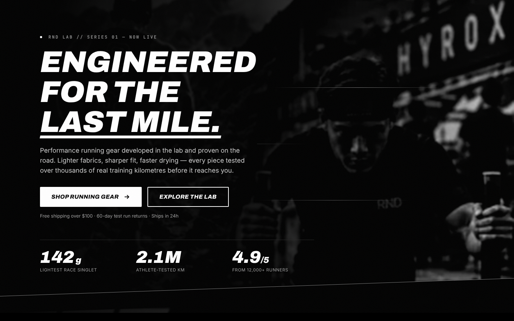

# RND Athlete — Website

Official website for **RND Athlete**: research-driven performance gear for runners and hybrid athletes.

This repository holds the brand's website blueprint and the first production component, the homepage hero, built with HTML and Tailwind CSS in the black-and-white palette of the RND Athlete logo.



## What's inside

| Path | What it is |
| --- | --- |
| `index.html` | Homepage hero, production version (uses compiled CSS and self-hosted fonts) |
| `dist/styles.css` | Compiled, minified Tailwind CSS. Committed so the site runs without a build |
| `src/input.css` | Tailwind source: font faces, Tailwind layers, hero effects |
| `tailwind.config.js` | Brand tokens: colours, fonts, animations |
| `prototype/hero-cdn.html` | Single-file version of the hero using the Tailwind CDN, for quick experiments |
| `assets/brand/` | Logo banner and emblem (low resolution, see "Before launch") |
| `assets/fonts/` | Archivo, Inter and JetBrains Mono (SIL Open Font License) |
| `assets/img/hero-poster.jpg` | Placeholder hero still cropped from the brand banner |
| `docs/website-blueprint.md` | Full website blueprint: brand system, homepage, PDP, Run Club, navigation, footer |
| `docs/screenshots/` | Hero at desktop, tablet, mobile and the CTA hover state |
| `.github/workflows/deploy.yml` | Publishes the site to GitHub Pages on every push to `main` |

## Brand tokens

| Token | Hex | Use |
| --- | --- | --- |
| `ink` | `#000000` | Background (logo black) |
| `carbon` | `#111111` | Cards, nav |
| `graphite` | `#262626` | Borders |
| `steel` | `#5C5C5C` | Disabled |
| `smoke` | `#A3A3A3` | Secondary text |
| `chalk` | `#E6E6E6` | White-button hover |
| `white` | `#FFFFFF` | Headlines, primary actions (logo white) |
| `signal` | `#FF3B30` | Errors and low stock only |

Display type is **Archivo Black Italic** (closest free match to the wordmark), body is **Inter**, data is **JetBrains Mono**.

## Run it locally

Open `index.html` in a browser. No build is needed, because `dist/styles.css` is committed.

To change styles:

```bash
npm install
npm run dev      # rebuilds dist/styles.css on every save
npm run build    # minified production build
npm run serve    # local server at http://localhost:3000
```

Run `npm run build` and commit `dist/styles.css` after any change to classes, `src/input.css` or `tailwind.config.js`.

## Upload to GitHub

1. Create an empty repository on GitHub (no README, licence or .gitignore), for example `rnd-athlete-website`.
2. From this folder, run:

   ```bash
   git remote add origin https://github.com/<your-username>/rnd-athlete-website.git
   git branch -M main
   git push -u origin main
   ```

3. To publish it, go to the repository's **Settings → Pages** and set **Source** to **GitHub Actions**. The included workflow deploys every push to `main`, and the site appears at `https://<your-username>.github.io/rnd-athlete-website/`.

## Before launch

- [ ] Replace `assets/brand/` files with the logo as SVG (emblem and wordmark).
- [ ] Replace `assets/img/hero-poster.jpg` with a full-resolution black-and-white hero still, and add `assets/video/hero-loop.webm` and `.mp4` (6–10 s, under 3 MB).
- [ ] Replace placeholder stats, product specs, prices and testimonials with real, verified content.
- [ ] Build the remaining sections from `docs/website-blueprint.md`: navigation, category grid, Lab section, bestsellers, social proof, Run Club, footer.

## Licence

© 2026 RND Athlete. All rights reserved. Brand assets and photography may not be reused without permission. Bundled fonts are under the SIL Open Font License.
